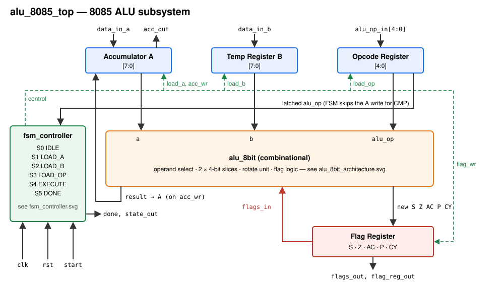
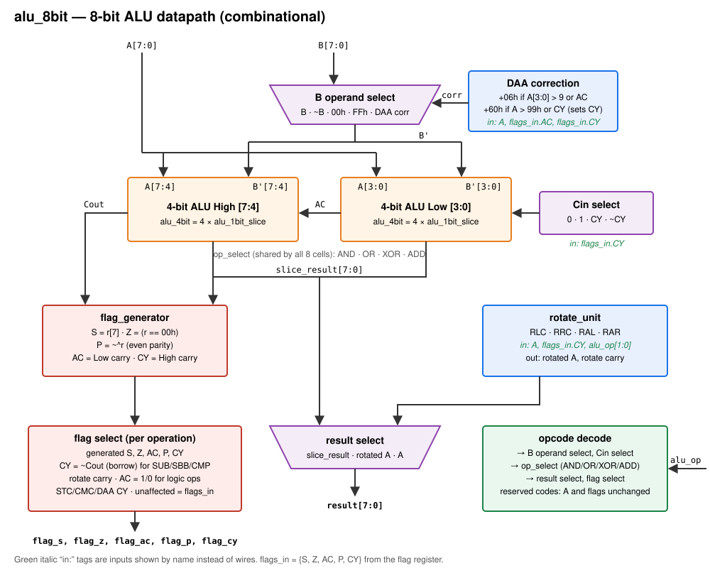
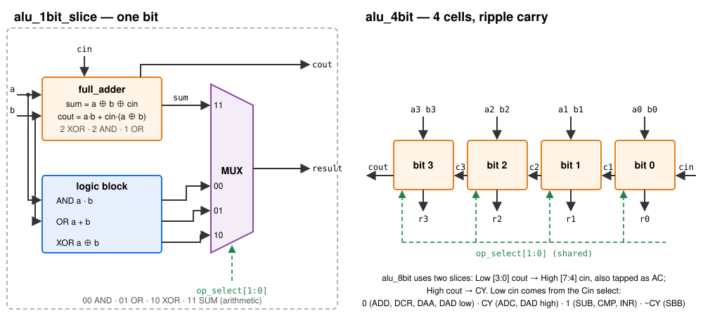
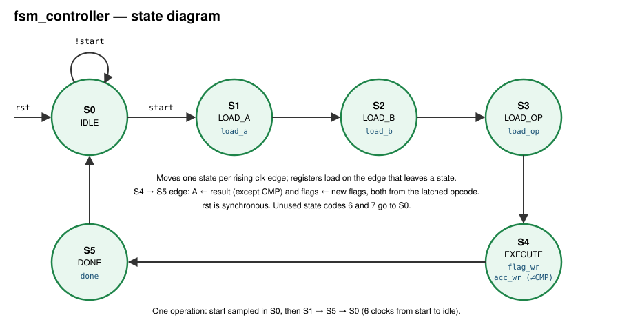

# 8085 ALU — Architecture

This document describes the design in `rtl/` from the top down: the clocked
subsystem, the combinational 8-bit ALU, the bit-slices it is built from, the
flag rules, and the controller. The operation list is in the
[README](../README.md#supported-operations).

## 1. Subsystem (`alu_8085_top`)



The subsystem holds three input registers (Accumulator A, Temp Register B,
Opcode Register), the Flag Register, the FSM controller and the
combinational `alu_8bit`.

| Port | Dir | Width | Description |
|------|-----|-------|-------------|
| `clk` | in | 1 | Clock (all registers update on the rising edge) |
| `rst` | in | 1 | Synchronous reset, active high: A = 00h, flags = S0 Z1 AC0 P1 CY0 |
| `start` | in | 1 | Starts one operation when the FSM is idle |
| `data_in_a` | in | 8 | Loaded into A in S1 |
| `data_in_b` | in | 8 | Loaded into B in S2 |
| `alu_op_in` | in | 5 | Loaded into the Opcode Register in S3 |
| `acc_out` | out | 8 | Accumulator A |
| `flags_out` | out | 5 | `{S, Z, AC, P, CY}` |
| `flag_reg_out` | out | 8 | 8085 PSW layout `{S, Z, 0, AC, 0, P, 0, CY}` |
| `done` | out | 1 | High for one clock (S5) when the operation has completed |
| `state_out` | out | 3 | Current FSM state (debug) |

The ALU always reads the *registered* operands, the *latched* opcode and the
current flags, so the result is stable through S4. On the S4 → S5 clock edge
the result is written to A (every operation except CMP) and the new flags are
written to the Flag Register. The ALU passes through any flag an operation
does not affect, so the Flag Register can be written unconditionally.

## 2. 8-bit ALU (`alu_8bit`)



The ALU is purely combinational. One adder/logic path (two 4-bit slices) does
every arithmetic and logic operation; the opcode decode only chooses what is
fed into it and what is taken out:

| Op | B′ (operand select) | Cin | Slice mode | Result | Flags written |
|----|---------------------|-----|------------|--------|---------------|
| ADD | B | 0 | ADD | slice | all |
| ADC | B | CY | ADD | slice | all |
| SUB | ~B | 1 | ADD | slice | all, CY = borrow |
| SBB | ~B | ~CY | ADD | slice | all, CY = borrow |
| ANA | B | 0 | AND | slice | S, Z, P; AC = 1; CY = 0 |
| XRA | B | 0 | XOR | slice | S, Z, P; AC = 0; CY = 0 |
| ORA | B | 0 | OR | slice | S, Z, P; AC = 0; CY = 0 |
| CMP | ~B | 1 | ADD | slice (A not written) | all, CY = borrow |
| RLC, RRC, RAL, RAR | — | — | — | rotate unit | CY = rotate carry |
| CMA | FFh | 0 | XOR | slice (A ⊕ FFh = ~A) | none |
| STC | — | — | — | A | CY = 1 |
| CMC | — | — | — | A | CY = ~CY |
| INR | 00h | 1 | ADD | slice | S, Z, AC, P |
| DCR | FFh | 0 | ADD | slice (A + FFh = A − 1) | S, Z, AC, P |
| DAA | 00h / 06h / 60h / 66h | 0 | ADD | slice | all (see §4) |
| DADL | B | 0 | ADD | slice | CY |
| DADH | B | CY | ADD | slice | CY |
| reserved | — | — | — | A | none |

Subtraction is A + ~B + 1: the operand select inverts B and the carry-in
supplies the +1 (or ~CY for SBB, which subtracts the borrow). The adder's
carry-out is then the inverse of the borrow, so the flag logic stores
CY = ~Cout for SUB, SBB and CMP.

## 3. Bit-slices (`alu_1bit_slice`, `alu_4bit`, `full_adder`)



**1-bit cell.** Each cell computes four results in parallel and a 4:1 MUX
picks one with the shared `op_select[1:0]`:

| `op_select` | Output | Used by |
|-------------|--------|---------|
| `00` | A · B | ANA |
| `01` | A + B | ORA |
| `10` | A ⊕ B | XRA, CMA (with B′ = FFh) |
| `11` | Full Adder sum | ADD, ADC, SUB, SBB, CMP, INR, DCR, DAA, DADL, DADH |

The full adder is gate level: Sum = A ⊕ B ⊕ Cin and
Cout = A·B + Cin·(A ⊕ B). Its carry-out is always produced; it is only
meaningful in arithmetic mode, and the ALU ignores it for logic operations.

**4-bit slice.** Four cells with a ripple carry: Cin → bit 0 → bit 1 → bit 2
→ bit 3 → Cout.

**8-bit ALU.** Two slices. The Low slice's Cout is the High slice's Cin and
is also the AC flag (carry out of bit 3). The High slice's Cout is the
carry out of bit 7 (CY, or ~borrow for subtraction).

**Approximate gate count** (slices only; the operand select, rotate unit,
flag logic and decode are extra):

| Component | Gates |
|-----------|-------|
| Full adder | 2 XOR + 2 AND + 1 OR = 5 |
| Logic block | 1 AND + 1 OR + 1 XOR = 3 |
| 4:1 MUX | ≈ 6 |
| Per bit | ≈ 14 |
| 8 bits (two slices) | ≈ 112 |

The ripple carry is simple and slow (delay grows with width), which is in
keeping with the 8085's era.

## 4. Flags

```
Bit:   7    6    5    4    3    2    1    0
     ┌────┬────┬────┬────┬────┬────┬────┬────┐
     │ S  │ Z  │ 0  │ AC │ 0  │ P  │ 0  │ CY │   flag_reg_out
     └────┴────┴────┴────┴────┴────┴────┴────┘
```

| Flag | Meaning when generated |
|------|------------------------|
| S | result bit 7 |
| Z | result = 00h |
| AC | carry out of bit 3 (Low slice Cout) |
| P | even parity of the result (XNOR of all 8 bits) |
| CY | carry out of bit 7; borrow for SUB/SBB/CMP |

Which flags each operation writes is in the table in §2; every other flag
keeps its previous value.

**AC after subtraction.** For SUB, SBB, CMP and DCR, AC is the carry out of
the low nibble of the two's-complement add A + ~B + ~borrow_in — not a
half-borrow. This is the 8080 behaviour; some 8085 references describe the
opposite (half-borrow) value. It only matters to code that reads AC after a
subtraction.

**DAA** (decimal adjust after an addition):

1. Add 06h if A[3:0] > 9 or AC = 1.
2. Add 60h if A > 99h or CY = 1. This also sets CY. DAA never clears CY.
3. S, Z, P come from the adjusted result; AC is the carry out of the low
   nibble of the correction add.

**DAD** (HL ← HL + rp) is issued as two operations, as the 8085 itself does
it in two 8-bit ALU passes:

1. `DADL` with A = L, B = low byte of rp → new L, CY = carry.
2. `DADH` with A = H, B = high byte of rp → new H, CY = 16-bit carry.

Only CY is affected; S, Z, AC and P are left as they were.

## 5. Controller (`fsm_controller`)



| State | Asserted | Next |
|-------|----------|------|
| S0 IDLE | — | S1 if `start`, else S0 |
| S1 LOAD_A | `load_a` | S2 |
| S2 LOAD_B | `load_b` | S3 |
| S3 LOAD_OP | `load_op` | S4 |
| S4 EXECUTE | `flag_wr`; `acc_wr` unless the latched opcode is CMP | S5 |
| S5 DONE | `done` | S0 |

`rst` is synchronous and returns to S0; the unused state codes 6 and 7 also
go to S0. The CMP decision uses the opcode latched in S3, not the raw input.

## 6. Verification

| Testbench | What it checks |
|-----------|----------------|
| `tb_full_adder` | All 8 input combinations |
| `tb_alu_4bit` | Directed tests + every {op_select, A, B, Cin} (2,048) |
| `tb_alu_8bit` | Directed tests + every {op, A, B, CY} (4,194,304), flags and result checked against `alu_ref_model.vh` |
| `tb_alu_8085_top` | Every {op, A, B} through the FSM (2,097,152), checked by a scoreboard; ADD + DAA for every BCD pair; 20,005 16-bit DAD additions; reset, `done` and PSW layout |

`tb/alu_ref_model.vh` is a behavioural model written with plain wide
arithmetic, independent of the slice structure. Compile the 8-bit and top
testbenches with `-I tb` so the `` `include `` resolves.
